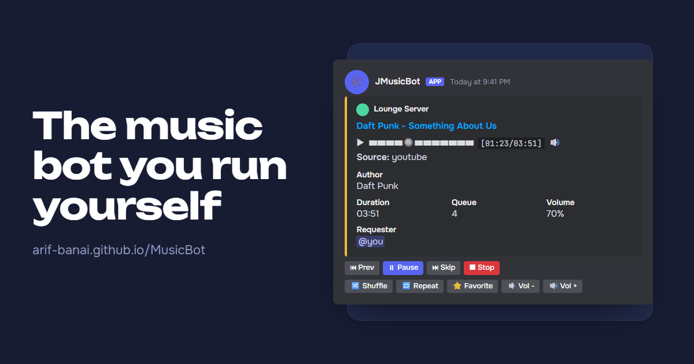

<a href="https://arif-banai.github.io/MusicBot/"></a>

# JMusicBot

A Discord music bot you run yourself. Fork of [arif-banai/MusicBot](https://github.com/arif-banai/MusicBot)
(itself a fork of [jagrosh's JMusicBot](https://github.com/jagrosh/MusicBot)), maintained by clifford64.

[](https://github.com/clifford64/MusicBot/releases/latest)
[](https://github.com/clifford64/MusicBot/releases/latest)
[](https://discord.gg/cyyUxNmmx6)
[](https://github.com/clifford64/MusicBot/actions/workflows/build-and-test.yml)

- Plays YouTube, SoundCloud, Bilibili, internet radio and your own files, with no API keys
- Slash commands that suggest songs as you type
- A now-playing panel with buttons for pause, skip, volume and more
- Queue, history and saved playlists
- An optional [yt-dlp library](https://arif-banai.github.io/MusicBot/features/ytdlp-library/) for songs that won't stream

## Running with Docker (recommended)

Image: `ghcr.io/clifford64/musicbot` — use `latest`, or pin a version tag such as `0.8.1` for production.
Multi-arch (amd64/arm64). [Published images](https://github.com/clifford64/MusicBot/pkgs/container/musicbot).

Mount a folder at `/musicbot` for `config.txt`, settings and playlists. On first run the bot generates a default
`config.txt` there — add your Discord bot token before the next start.

```bash
mkdir -p ~/jmusicbot && docker run --rm -it --name jmusicbot \
  -v ~/jmusicbot:/musicbot ghcr.io/clifford64/musicbot:latest
```

Unlike the upstream image, the container starts as root, **fixes ownership of the mounted folder itself**, and
drops to UID/GID `10001:10001` before starting the bot — no pre-`chown` step, and the bot never runs as root.
Change the fallback with `MUSICBOT_UID`/`MUSICBOT_GID`, or run as yourself with `-u "$(id -u):$(id -g)"`
(the folder just needs to be writable by that user). For a backgrounded setup, copy
[docker-compose.example.yml](docker-compose.example.yml) — it also documents `JAVA_OPTS` heap limits.

## Setup and documentation

[Setup guide](https://arif-banai.github.io/MusicBot/setup/) · [Docker](https://arif-banai.github.io/MusicBot/setup/docker/) ·
[Commands](https://arif-banai.github.io/MusicBot/reference/commands/) · [config.txt](https://arif-banai.github.io/MusicBot/reference/config/) ·
[Troubleshooting](https://arif-banai.github.io/MusicBot/help/troubleshooting/) · [Migrating](https://arif-banai.github.io/MusicBot/migrating/) · [All docs](https://arif-banai.github.io/MusicBot/)

## Help and contributing

Questions in [Discussions](https://github.com/clifford64/MusicBot/discussions) or on [Discord](https://discord.gg/cyyUxNmmx6);
bugs and feature requests in [Issues](https://github.com/clifford64/MusicBot/issues). Branch naming and the release
flow are in [DEVELOPMENT_WORKFLOW.md](docs/DEVELOPMENT_WORKFLOW.md).

This bot is built on [JDA](https://github.com/DV8FromTheWorld/JDA), [lavaplayer](https://github.com/lavalink-devs/lavaplayer) and
[youtube-source](https://github.com/lavalink-devs/youtube-source). If you like it, give them a star too.

## License

[Apache 2.0](LICENSE)
